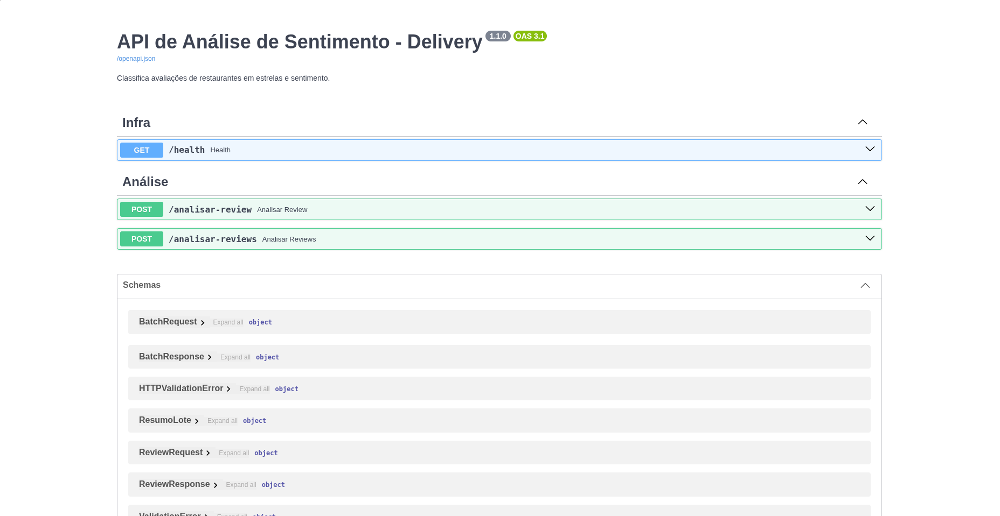

# 🍔 API de Análise de Sentimento para Avaliações de Delivery


API REST que classifica automaticamente avaliações de restaurantes e pedidos de
delivery, retornando a nota prevista (1 a 5 estrelas) e o sentimento geral
(positivo, neutro ou negativo).

Construída com **Python, FastAPI e Hugging Face Transformers**, totalmente
conteinerizada com **Docker** e com testes automatizados em **pytest**.

<!-- Coloque aqui um print do Swagger (http://localhost:8000/docs) -->
<!--  -->

---

## 🎯 Problema de negócio

Plataformas de delivery recebem milhares de avaliações em texto livre todos os
dias. Lê-las manualmente é inviável, e muitas vezes a nota em estrelas não
reflete o que o cliente escreveu (ex.: nota 5 com um comentário reclamando da
entrega).

**Esta API permite a triagem automática das avaliações para:**

- 🚨 **Priorizar** avaliações negativas para o time de atendimento e parcerias;
- 📊 **Monitorar** a satisfação por restaurante, região ou período;
- 🔍 **Detectar** inconsistências entre a nota dada e o texto escrito;
- ⚡ **Reduzir** o tempo de resposta a clientes insatisfeitos.

---

## 🧠 Como funciona

```
Cliente ──POST──▶ FastAPI ──▶ Pipeline Hugging Face ──▶ Resposta JSON
               (validação      (BERT multilíngue
                Pydantic)       nlptown)
```

- **Modelo:** [`nlptown/bert-base-multilingual-uncased-sentiment`](https://huggingface.co/nlptown/bert-base-multilingual-uncased-sentiment),
  um BERT multilíngue (inclui português) que prevê de 1 a 5 estrelas.
- **Regra de sentimento:**

| Estrelas | Sentimento |
|:--------:|:----------:|
| 1–2      | negativo   |
| 3        | neutro     |
| 4–5      | positivo   |

### Decisões técnicas

- **Modelo carregado uma única vez** na inicialização (`lifespan`), e não a cada requisição.
- **Endpoints síncronos (`def`)**: a inferência é CPU-bound e bloqueante; assim o
  FastAPI a executa em uma thread pool sem travar o event loop.
- **Validação com Pydantic**: entradas inválidas (vazio, tipo errado, texto muito longo)
  retornam `422` automaticamente.
- **Limites de segurança**: máximo de 2000 caracteres por avaliação e 50 avaliações por lote.
- **Erros internos não vazam detalhes**: o stack trace vai para o log; o cliente recebe uma mensagem genérica.
- **Imagem Docker enxuta**: PyTorch versão CPU, usuário não-root e modelo baixado durante o build.

---

## 🚀 Como rodar

### Pré-requisito
- [Docker](https://docs.docker.com/get-docker/) instalado.

### 1. Construir a imagem
```bash
docker build -t sentimento-delivery .
```
> ⏳ O primeiro build demora (baixa o PyTorch e o modelo). Os próximos são rápidos.

### 2. Executar o container
```bash
docker run --rm -p 8000:8000 sentimento-delivery
```

### 3. Testar

**Documentação interativa (Swagger):** http://localhost:8000/docs

---

## 📡 Endpoints

| Método | Rota                | Descrição                                          |
|--------|---------------------|----------------------------------------------------|
| POST   | `/analisar-review`  | Analisa **uma** avaliação                          |
| POST   | `/analisar-reviews` | Analisa até 50 avaliações em uma única requisição  |
| GET    | `/health`           | Verifica se a API e o modelo estão carregados      |

**Códigos de resposta:** `200` sucesso · `422` entrada inválida · `500` erro interno.

### `POST /analisar-review`

**Requisição**
```bash
curl -X POST http://localhost:8000/analisar-review \
  -H "Content-Type: application/json" \
  -d '{"review": "Adorei! Chegou rápido e estava delicioso."}'
```

**Resposta** *(valores ilustrativos)*
```json
{
  "review": "Adorei! Chegou rápido e estava delicioso.",
  "estrelas": 5,
  "confianca": 0.81,
  "sentimento": "positivo",
  "probabilidades": {"1": 0.02, "2": 0.01, "3": 0.04, "4": 0.12, "5": 0.81}
}
```

### `POST /analisar-reviews` (lote)

**Requisição**
```bash
curl -X POST http://localhost:8000/analisar-reviews \
  -H "Content-Type: application/json" \
  -d '{"reviews": ["Pedido chegou frio.", "Adorei, estava delicioso!"]}'
```

**Resposta** *(resumida, valores ilustrativos)*
```json
{
  "resumo": {
    "total": 2,
    "positivos": 1,
    "neutros": 0,
    "negativos": 1,
    "media_estrelas": 3.0
  },
  "resultados": [
    {"review": "Pedido chegou frio.", "estrelas": 1, "sentimento": "negativo", "...": "..."},
    {"review": "Adorei, estava delicioso!", "estrelas": 5, "sentimento": "positivo", "...": "..."}
  ]
}
```
> Os resultados vêm **na mesma ordem** da lista enviada.

---

## ✅ Testes

Os testes usam um **modelo simulado (mock)**, então rodam em segundos e não
exigem o download do BERT. Eles cobrem validação de entrada, formato da resposta,
regra de sentimento, ordem do lote e tratamento de erros.

```bash
python -m venv .venv
source .venv/bin/activate        # Windows: .venv\Scripts\activate
pip install -r requirements-dev.txt
pytest -v
```

Os testes também rodam automaticamente a cada `push` via **GitHub Actions**
(ver `.github/workflows/ci.yml`).

### Teste manual com o modelo real

Com a API no ar, o script abaixo envia as avaliações do arquivo `reviews.json`
(uma requisição por avaliação) e imprime o resultado:

```bash
python testar_reviews.py
```

---

## ⚠️ Limitações conhecidas

Em testes manuais com 18 avaliações, o modelo acertou a maioria, mas errou em
casos com números no texto e expressões neutras:

| Avaliação | Esperado | Obtido | Confiança |
|---|---|---|:---:|
| "Atendimento nota 10, o pedido chegou antes do previsto." | positivo | negativo (1★) | 0.34 |
| "Nem bom nem ruim, deu pra matar a fome." | neutro | negativo (1★) | 0.61 |

Possíveis causas (hipóteses, já que o modelo é uma "caixa-preta"):

- O modelo foi treinado com avaliações de **produtos**, não de delivery;
  vocabulário de logística ("chegou antes do previsto") é pouco conhecido por ele.
- Números no texto (como "nota 10") podem confundir o modelo.
- Textos com sentimentos mistos (comida boa, entrega ruim) tendem a cair em notas intermediárias.
- Os erros observados tiveram **confiança relativamente baixa**, o que sugere
  usar esse campo como sinal de alerta.

---

## 🔭 Próximos passos

- [x] Endpoint de processamento em lote
- [x] Testes automatizados com `pytest`
- [x] CI com GitHub Actions
- [ ] Sinalizar avaliações de baixa confiança para revisão manual
- [ ] Análise de sentimento por aspecto (comida, entrega, atendimento)
- [ ] Fine-tuning com avaliações em português brasileiro
- [ ] Cache de resultados e métricas (Prometheus)

---

## 📁 Estrutura do projeto

```
.
├── .github/workflows/ci.yml   # pipeline de CI
├── main.py                    # API FastAPI
├── test_main.py               # testes automatizados (pytest)
├── testar_reviews.py          # script de teste manual (precisa da API no ar)
├── reviews.json               # avaliações de exemplo
├── requirements.txt           # dependências de produção
├── requirements-dev.txt       # dependências de desenvolvimento (pytest, httpx)
├── Dockerfile
└── README.md
```

## 🛠️ Stack

Python 3.11 · FastAPI · Pydantic · Hugging Face Transformers · PyTorch · Docker · pytest · GitHub Actions

---

## 👤 Autor

**Murilo Snovais**
<!-- [LinkedIn](https://www.linkedin.com/in/murilo-santana-novais-4b4601236/)